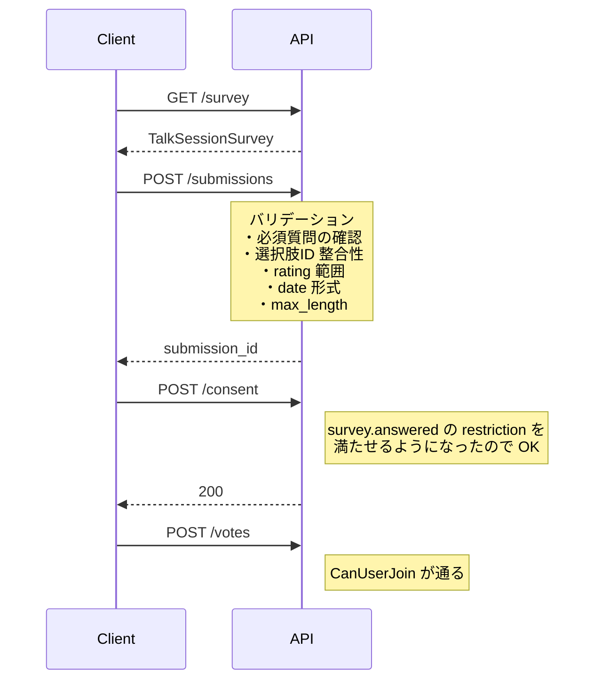

# トークセッション参加アンケート

セッション参加前に回答必須のアンケートを設定できる機能。
回答していないユーザーは vote / opinion を投稿できない。

## 設計方針

### 1. 既存の Restriction システムに統合

参加ゲートは `RestrictionAttribute` の枠組みで表現する。新しい restriction key
`survey.answered` を追加し、`CanUserJoin` で既存の demographics 系制限と同じく
評価される。

利点：
- `/talksessions/{id}/restrictions/satisfied` がそのままアンケート未回答を返せる
- vote / opinion 用の access control を変更不要
- 同意レコード (`talksession_consents.restrictions`) にスナップショットされる

### 2. talk_session : survey は 1 : 0..1 の密結合

- 1 セッションあたり最大 1 アンケート
- セッション作成時のみ作成可能（後付けは不可）
- セッション削除時に CASCADE で消える

### 3. 編集は柔軟、破壊は安全側

- オーナーはいつでも質問・選択肢を **追加・編集** できる
- 回答が 1 件でもある質問・選択肢は **soft delete のみ**（DB には残る、表示から消える）
- 回答ゼロの質問・選択肢は hard delete 可
- 必須質問を追加しても **既存 submission は有効のまま**（参加ゲートは passed 扱い）

### 4. 回答は 1 ユーザー 1 送信、修正不可

- `UNIQUE(survey_id, user_id)` で DB 制約
- 一度送信したら以降は 409 Conflict
- 「やり直し」が必要なら別途 admin API を設計する

### 5. PII / 暗号化は今回スコープ外

`contains_pii` フラグと AES-GCM で per-question 暗号化はkotohiroのMVPでは含めない。必要になったら別 PR で追加する。

## スキーマ

### `talk_session_surveys`

セッションと 1:0..1 で対応。

| カラム | 型 | 説明 |
|---|---|---|
| survey_id | UUID PK | |
| talk_session_id | UUID NOT NULL UNIQUE | `talk_sessions` への FK、CASCADE |
| created_at, updated_at | TIMESTAMPTZ | |

### `talk_session_survey_questions`

| カラム | 型 | 説明 |
|---|---|---|
| question_id | UUID PK | |
| survey_id | UUID NOT NULL | FK CASCADE |
| question_text | TEXT NOT NULL | |
| question_type | enum | `free_text` / `single_choice` / `multi_choice` / `rating` / `date` / `dropdown` |
| is_required | BOOLEAN | |
| allow_other | BOOLEAN | choice 系で「その他」を許可 |
| max_length | INT | free_text / other の文字数上限 |
| min_value, max_value | INT | rating の範囲 |
| min_label, max_label | VARCHAR(255) | rating の端点ラベル |
| display_order | INT | |
| deleted_at | TIMESTAMPTZ | soft delete |

部分インデックス：`WHERE deleted_at IS NULL` で生きている質問のみ高速取得。

### `talk_session_survey_choices`

| カラム | 型 | 説明 |
|---|---|---|
| choice_id | UUID PK | |
| question_id | UUID NOT NULL | FK CASCADE |
| choice_text | VARCHAR(500) | |
| display_order | INT | |
| deleted_at | TIMESTAMPTZ | soft delete |

### `talk_session_survey_submissions`

| カラム | 型 | 説明 |
|---|---|---|
| submission_id | UUID PK | |
| survey_id | UUID NOT NULL | FK CASCADE |
| user_id | UUID NOT NULL | FK CASCADE |
| submitted_at | TIMESTAMPTZ | |
| UNIQUE(survey_id, user_id) | | 1 ユーザー 1 送信 |

### `talk_session_survey_answers`

| カラム | 型 | 説明 |
|---|---|---|
| answer_id | UUID PK | |
| submission_id | UUID NOT NULL | FK CASCADE |
| question_id | UUID NOT NULL | FK（CASCADEなし、soft delete でリンク維持） |
| answer_value | JSONB NOT NULL | 質問タイプによって構造が変わる |

#### `answer_value` JSONB 形式

```jsonc
// free_text
{ "text": "..." }

// single_choice / dropdown
{ "selectedChoiceIDs": ["uuid"] }
// または allowOther=true で「その他」選択時
{ "other": "..." }

// multi_choice
{ "selectedChoiceIDs": ["uuid1", "uuid2"], "other": "..." }

// rating
{ "rating": 4 }

// date
{ "date": "2026-06-14" }
```

## API

| Method | Path | 説明 |
|---|---|---|
| GET | `/talksessions/{id}/survey` | 定義取得（参加前にクライアントが質問取得） |
| POST | `/talksessions/{id}/survey` | オーナー：アンケート作成（1セッション1件） |
| PUT | `/talksessions/{id}/survey` | オーナー：編集（質問追加・並べ替え・回答済み質問の soft delete） |
| POST | `/talksessions/{id}/survey/submissions` | ユーザー：回答送信 |
| GET | `/talksessions/{id}/survey/submissions` | オーナー：回答一覧取得 |

詳細は `tsp/routes/talk-session-survey.tsp` と `static/oas/openapi.yaml`。

## 参加フロー



## バリデーション

### 質問タイプごとの answer_value 必須項目

| type | 必須フィールド | 補足 |
|---|---|---|
| free_text | `text` | `max_length` を超えたら 400 |
| single_choice | `selectedChoiceIDs`（1件） または `other`（allowOther=true 時） | |
| multi_choice | `selectedChoiceIDs`（1件以上）または `other` | 重複ID は 400 |
| rating | `rating`（min_value 〜 max_value） | |
| date | `date`（YYYY-MM-DD） | parse エラーは 400 |
| dropdown | single_choice と同じ | |

### 必須質問

`is_required=true` の質問に対して `answer_value` が空（text 空文字、selectedChoiceIDs 空配列など）の場合は 400。

### 同一質問への重複回答

1 submission 内に同じ `question_id` が複数含まれていたら 400。

## 編集ルール

### 削除の許可判定（usecase 層で検証）

| 対象 | 回答ゼロ | 回答 1件以上 |
|---|---|---|
| 質問（hard delete） | OK | NG（409） |
| 質問（soft delete = `deleted_at` 設定） | OK | OK |
| 選択肢（hard delete） | OK | NG（409、その選択肢が選ばれていなければ OK） |
| 選択肢（soft delete） | OK | OK |

### 編集による参加ゲートへの影響

- 「必須質問の追加」をしても、既に submission を持つユーザーは引き続き参加可能
- 新規参加ユーザーは追加された必須質問を含めて回答する必要あり

## restriction key の自動付与

`/talksessions` 作成時に `survey: { questions: [...] }` が指定された場合：
1. `talk_sessions.restrictions` に `"survey.answered"` を追加
2. `talk_session_surveys` レコードを作成
3. 後続の `CanUserJoin` で自動的にゲート判定される

## 残作業（今回の PR には含まない）

- Domain model 実装（`internal/domain/model/talksession/survey/`）
- Repository 実装（`internal/infrastructure/persistence/repository/`）
- sqlc クエリ（`internal/infrastructure/persistence/sqlc/queries/`）
- UseCase 実装（`internal/application/usecase/talksession_usecase/`）
- Handler 実装（現在は `talk_session_survey_handler.go` に 500 を返すスタブのみ）
- `survey.answered` restriction key の登録
- StartTalkSessionUseCase の survey 受け入れ拡張
- ドメインイベント（必要なら）
- e2e シナリオ
