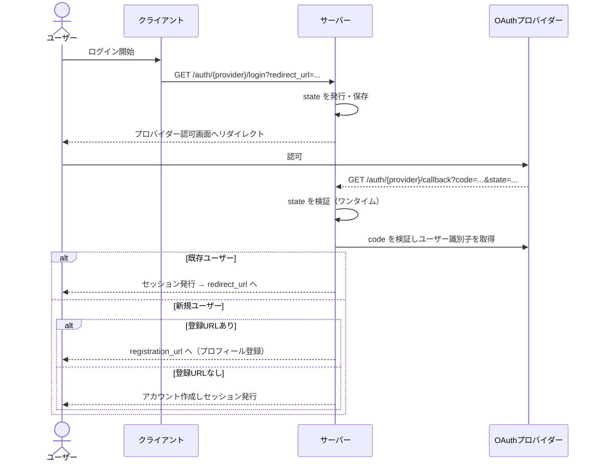
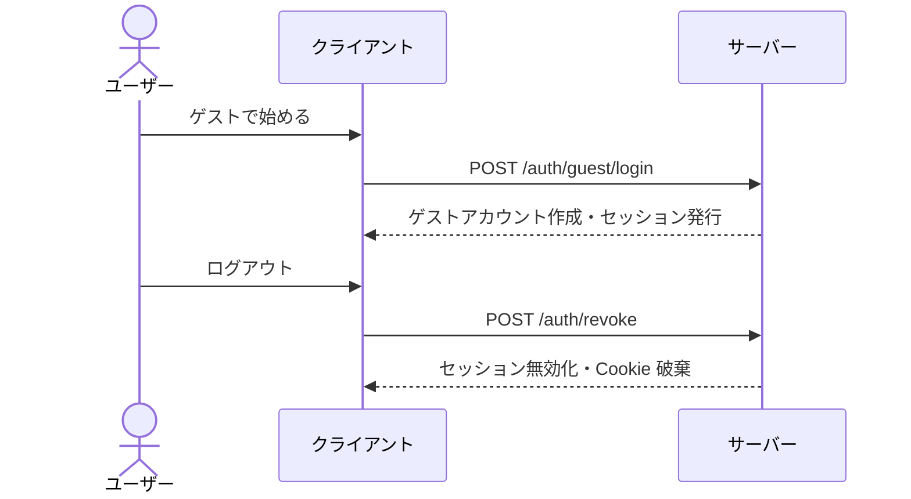

# 認証 仕様

## 概要

認証は、ユーザーがログインしてセッションを確立し、保護された機能（セッション作成・参加・意見投稿・投票など）を利用できるようにする機能。
外部プロバイダー（Google / LINE）によるOAuthログインに加え、登録不要で始められるゲストログインを提供する。
ログイン状態はサーバー側セッションとして管理され、Cookie で受け渡される。

---

## 用語

| 用語 | 説明 |
| --- | --- |
| OAuthプロバイダー（provider） | 外部のログイン提供元。Google / LINE |
| ゲストログイン | 外部アカウントなしで始められる簡易ログイン。機能制限がある |
| セッション | ログイン状態を表すサーバー側の記録。Cookie で識別される |
| state | OAuthの正当性検証に使う一時的な値（CSRF対策） |
| リダイレクトURL（redirect_url） | ログイン完了後に戻る画面のURL |
| 登録URL（registration_url） | 未登録ユーザーをプロフィール登録へ誘導する画面のURL |
| 組織コード（organization_code） | 組織としてログインする際の識別コード |

---

## ユーザーフロー

### OAuthログイン（Google / LINE）

1. ユーザーがログインを開始する。クライアントは戻り先（redirect_url）を指定する
2. サーバーがプロバイダーの認可画面へ誘導する
3. ユーザーがプロバイダー側で認可する
4. プロバイダーからの戻りをサーバーが受け取り、正当性を検証する
5. アカウントの状態に応じて分岐する
   - 既存ユーザー: セッションを確立し、戻り先へリダイレクトする
   - 新規ユーザー: 登録URLが指定されていればプロフィール登録へ誘導し、なければそのままアカウントを作成してセッションを確立する
6. セッションが Cookie で発行される

### ゲストログイン

1. ユーザーがゲストとしてログインする
2. ゲスト用のアカウントとセッションが作成される
3. 制限のないセッションであれば参加・意見投稿・投票ができる
4. 後から Google / LINE でログインすると正規ユーザーへ移行できる

### ログアウト

1. ユーザーがログアウトする
2. 現在のセッションが無効化され、Cookie が破棄される

### アカウント復活

退会後一定期間内であれば、ログインしたうえで復活操作によりアカウントを元に戻せる。詳細は [退会](./withdraw.md) を参照。

---

## 呼び出しフロー

### OAuthログイン

### ゲストログイン・ログアウト

---

## ルールと制約

### 対応するログイン方式

| 方式 | 説明 |
| --- | --- |
| Google | OAuthログイン |
| LINE | OAuthログイン |
| ゲスト | 登録不要の簡易ログイン |

- 開発環境向けのログイン方式（開発用ログイン・パスワードログイン）が別途存在するが、本番では利用しない

### 初回ログイン時のアカウント作成

- OAuthログインで未登録の識別子が来た場合、新規ユーザーとして扱う
- 登録URLが指定されていればプロフィール登録へ誘導し、未指定なら自動でアカウントを作成する
- ゲストログインは常に新しいゲストアカウントを作成する（[ユーザー](./user.md)のプロフィール登録で正規化される）

### セッションと有効期限

- ログイン状態はサーバー側セッションとして管理し、Cookie で受け渡す
- セッションには有効期限があり、通常ユーザーとゲストユーザーで期限が異なる（ゲストの方が長い）
- ログアウトすると現在のセッションは無効化される
- OAuthの state には短い有効期限があり、一度使うと無効になる

### ゲストユーザーの制限

- ゲストユーザーは参加制限のあるセッションには参加できない
- ゲストユーザーは表示名を変更できない（[ユーザー](./user.md)参照）
- Google / LINE でログインすると正規ユーザーへ移行できる

### 退会・復活

- 退会したアカウントで保護された機能にアクセスすると復活が必要になる。退会・復活の詳細は [退会](./withdraw.md) を参照

### 組織ログイン

- 組織コードを指定して組織としてログインでき、セッションに組織情報が紐付く。詳細は [組織認証ドキュメント](../organization-authentication.md) を参照

---

## 関連ドキュメント

- [ユーザー](./user.md) — プロフィール登録・編集
- [退会](./withdraw.md) — 退会と復活
- [組織認証](../organization-authentication.md) — 組織としてのログイン
