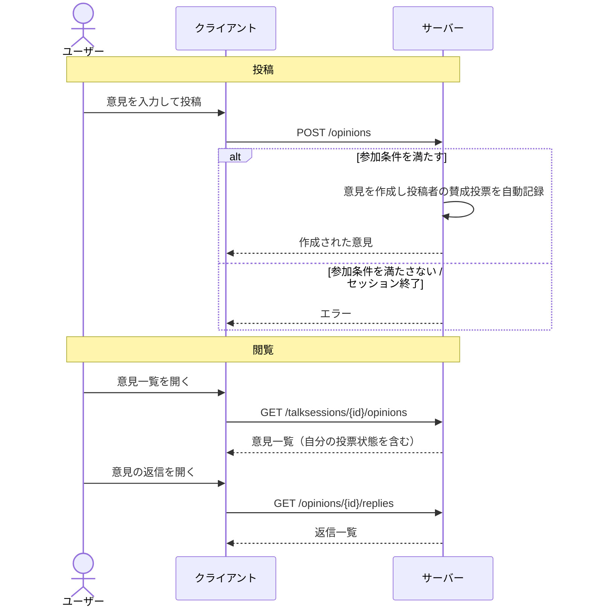

# 意見 仕様

## 概要

意見は、[トークセッション](./talk-session.md)の中でユーザーが投稿するテキスト（任意で画像・参考URL）の投稿。
他の意見への返信としてツリー状につながり、テーマに対する多様な視点を共有する。
各意見は[投票](./vote.md)の対象になり、賛成・反対の集計やグループ分析に使われる。

---

## 用語

| 用語 | 説明 |
| --- | --- |
| 意見（Opinion） | セッション内に投稿される 1 件の投稿 |
| 親意見（parentOpinionID） | 返信先の意見。指定がなければルート意見になる |
| ルート意見 | セッションに直接ぶら下がる、返信ではない意見 |
| 返信意見 | 既存の意見への返信として投稿される意見 |
| シード意見（isSeed） | オーナーが用意する初期意見。議論の起点として置かれる |
| 参考URL（referenceURL） / 参考画像 | 意見に添えられる補足情報 |

---

## ユーザーフロー

### 意見を投稿する

1. 参加者がセッションに対して意見を投稿する
   - 投稿には参加条件を満たしている必要がある（[参加アンケート](./talk-session-survey.md)が設定されていれば回答済みであること）
2. 任意でタイトル・参考URL・参考画像を添える
3. 意見が投稿され、投稿者には自動的にその意見への「賛成」投票が記録される

### 意見に返信する

1. 参加者が既存の意見を選んで返信を投稿する
2. 返信は親意見と同じセッションに属する意見としてツリーにつながる

### 意見を閲覧する

1. ユーザーがセッション内の意見一覧を表示する（認証不要）
   - 新着順 / 古い順 / 返信が多い順で並び替えられる
   - シード意見のみの絞り込みもできる
2. ユーザーが個別の意見と、その返信一覧を開く
3. ログイン済みなら、各意見に対する自分の投票状態も合わせて表示される

### スワイプで投票する

1. 参加者がスワイプ画面を開く
2. まだ投票していないルート意見が順に提示される（自分が投稿した意見は除く）
3. 参加者が賛成 / 反対 / 保留を選んでいく（[投票](./vote.md)）

### 意見を通報する

1. ユーザーが意見に対し通報理由を選んで通報する
2. 通報は対象セッションのオーナーが確認・対応する（[トークセッション](./talk-session.md)の通報対応）

---

## 呼び出しフロー

### 意見の投稿と閲覧

---

## ルールと制約

### 投稿の前提条件

- 投稿には認証が必要
- 投稿者はセッションの参加条件を満たしている必要がある（[参加アンケート](./talk-session-survey.md)未回答などでは投稿不可）
- 終了したセッションには投稿できない
- ゲストユーザーは制限付きセッションに参加できないため、そこには投稿できない

### 内容の制約

- 意見本文は必須で、文字数の上限がある
- タイトルは任意。指定する場合は文字数の範囲がある
- 参考URL・参考画像は任意。画像は所定の形式・サイズの制約を満たす必要がある

### ツリー構造

- 親意見を指定しない投稿はルート意見になる
- 親意見を指定した投稿は返信意見になり、親と同じセッションに属する
- 自分自身を親に指定することはできない

### 自動投票

- 意見を投稿すると、投稿者にその意見への「賛成」投票が自動的に記録される
- シード意見は議論の起点として扱われ、投稿者の自動投票は紐付かない

### シード意見

- シード意見はオーナーのみが設定できる
- オーナー以外がシード意見として投稿しようとすると拒否される

### 通報

- 任意のユーザーが意見を通報できる（理由は用意された一覧から選ぶ）
- 通報の確認・対応はそのセッションのオーナーが行う（未対応 / 削除済み / 保留で管理）

---

## 関連ドキュメント

- [トークセッション](./talk-session.md) — 意見が投稿される場
- [投票](./vote.md) — 意見への賛成 / 反対 / 保留
- [参加アンケート](./talk-session-survey.md) — 投稿の前提になる参加条件
