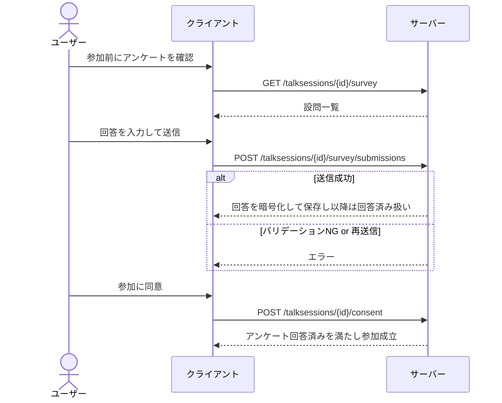
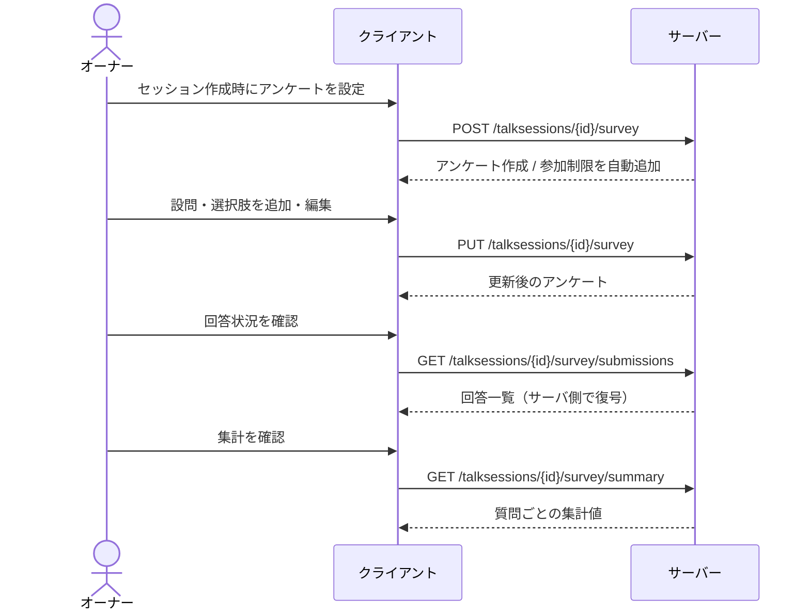

# 参加アンケート 仕様

## 概要

参加アンケートは、[トークセッション](./talk-session.md)への参加前に回答を必須にできるアンケート。
オーナーはセッション作成時にアンケートを設定でき、回答していないユーザーは意見投稿・投票ができない。
デモグラフィック属性では捉えられない、セッション固有の設問で参加者の背景を把握することを目的とする。

回答はすべて暗号化して保存される（後述）。

---

## 用語

| 用語 | 説明 |
| --- | --- |
| アンケート（Survey） | 1 セッションに最大 1 つ紐付く設問のまとまり |
| 質問（Question） | アンケート内の個々の設問。回答形式・必須/任意などを持つ |
| 選択肢（Choice） | 単一選択・ドロップダウンの設問に紐付く選択肢 |
| 回答送信（Submission） | ユーザーが全設問への回答をまとめて送信した記録。1 ユーザー 1 回のみ |
| 回答（Answer） | 各設問に対する個別の回答内容 |
| 集計（Summary） | アンケート全体の回答数および設問ごとの集計値。オーナーのみが取得できる |
| 参加制限「アンケート回答済み」（survey.answered） | アンケート回答を参加条件として表す[参加制限](./talk-session.md)のキー |

---

## アンケートの構成

### 設問の回答形式

回答形式は選択肢系の 2 種類のみをサポートする。

| 回答形式 | 説明 |
| --- | --- |
| 単一選択（single_choice） | 選択肢から 1 つを選ぶ。「その他」自由入力を許可できる |
| ドロップダウン（dropdown） | リストから 1 つを選ぶ。単一選択と同じ扱いで UI が異なる |

### 設問ごとの設定項目

| 設定 | 説明 |
| --- | --- |
| 設問文 | 質問のタイトル |
| 回答形式 | 上記 2 種から選択 |
| 必須/任意 | 回答を必須にするか |
| 「その他」自由入力 | 選択肢にない回答を自由入力で受け付ける |
| 文字数上限 | 「その他」入力に適用される上限 |
| 表示順 | アンケート内での設問の並び順 |

---

## ユーザーフロー

### アンケートの設定（オーナー）

1. オーナーがセッションを作成する際にアンケートを設定する
   - アンケートを設定するとセッションに「アンケート回答済み」の参加制限が自動で追加される
2. セッション作成後も、オーナーは設問・選択肢を追加・編集できる
3. オーナーは寄せられた回答の一覧を確認できる
4. オーナーは設問ごとに集計された結果（選択肢の件数・「その他」の件数）を確認できる

### アンケートへの回答（参加者）

1. ユーザーが参加前にアンケートの設問を確認する（認証不要）
2. ユーザーが各設問に回答して送信する
3. 送信が完了すると「アンケート回答済み」制限が満たされ、参加・意見投稿・投票ができるようになる
4. 一度送信したアンケートは修正できない

---

## 呼び出しフロー

### アンケート回答から参加まで



### アンケートの設定（オーナー）



---

## ルールと制約

### アンケートとセッションの関係

- 1 セッションにつきアンケートは最大 1 つ
- アンケートはセッション作成時のみ作成できる（後付け不可）
- セッションが削除されるとアンケートも消える

### 参加ゲートとしての扱い

- アンケートを設定すると、セッションに「アンケート回答済み（survey.answered）」の[参加制限](./talk-session.md)が自動で追加される
- この制限があるセッションでは、アンケート未回答のユーザーは[意見](./opinion.md)投稿・[投票](./vote.md)ができない
- 回答送信が完了すると制限が満たされ、参加できるようになる

### 回答のルール

- 1 ユーザーが回答を送信できるのは 1 回のみ。送信後の修正・取り消しはできない
- 必須設問が未回答の場合は送信できない（選択肢・「その他」のいずれも無い場合は未回答扱い）
- 選択肢は選択肢 ID で指定し、存在しない・削除済みの選択肢は指定できない
- 単一選択・ドロップダウンは選択肢か「その他」のいずれか一方で回答する（**排他**：両方は送れない）
- 「その他」入力は設定された文字数上限を超えられない
- 同じ設問への回答が重複していたり、アンケートに存在しない設問が含まれていると送信できない

### アンケートの編集

- オーナーはいつでも設問・選択肢を追加・編集できる
- 回答がまだ無い設問・選択肢は完全に削除できる
- 回答が 1 件でもある設問・選択肢は論理削除（表示から消すのみ）となり、既存回答との参照は残る
- 回答が 1 件でもある設問は回答形式を変更できない
- 必須設問を後から追加しても、既に回答済みのユーザーは参加可能なまま（追加分の回答は求められない）。新たに参加するユーザーは追加された設問を含めて回答する必要がある

### 回答の暗号化

- 回答はすべて AES-GCM で暗号化して保存される（`selectedChoiceIDs` / `other` を含む）
- 平文の回答値（選択肢 ID・「その他」テキスト）を JSON 化し、暗号化した文字列として `answer_value` に格納する
- 回答行ごとに保存時の暗号化状態（`is_encrypted`）を記録する
- 回答一覧をオーナーが取得する際はサーバー側で復号され、平文で返る
- 集計もサーバー側で復号してから行う（暗号化された選択肢 ID は DB では直接集計できないため）

### 集計の扱い

- 集計はオーナーのみが取得できる
- すべての回答をサーバー側で復号してから集計する
- 削除済み（soft delete）の設問・選択肢は集計対象に含まれない
- 編集で必須設問を後から追加した場合、追加前のユーザーはその設問への回答を持たないため `answerCount` が `submissionCount` を下回る

---

## API エンドポイント一覧

| Method | Path | 認証 | 概要 |
| --- | --- | --- | --- |
| `GET` | `/talksessions/{talkSessionID}/survey` | 不要 | アンケート定義を取得（参加前の質問プレビュー用） |
| `POST` | `/talksessions/{talkSessionID}/survey` | オーナー | アンケートを作成（1 セッション 1 件） |
| `PUT` | `/talksessions/{talkSessionID}/survey` | オーナー | アンケートを編集（追加・改名・soft/hard delete） |
| `POST` | `/talksessions/{talkSessionID}/survey/submissions` | 認証必須 | 回答を送信（1 ユーザー 1 回） |
| `GET` | `/talksessions/{talkSessionID}/survey/submissions` | オーナー | 寄せられた回答一覧（ページング対応） |
| `GET` | `/talksessions/{talkSessionID}/survey/summary` | オーナー | 設問ごとの集計値 |

詳細なスキーマは [OpenAPI 定義](../../static/oas/openapi.yaml) を参照。

---

## 回答ペイロード

回答送信の `answers[]` 各要素は `questionID` に加えて、選択肢か「その他」を設定する。

### single_choice / dropdown — 単一選択

```json
{ "questionID": "...", "selectedChoiceIDs": ["choice-uuid"] }
```

`allowOther: true` の質問で「その他」を選んだ場合は、選択肢の代わりに `other` を送る（**排他**：両方は送れない）。

```json
{ "questionID": "...", "other": "緑" }
```

---

## レスポンス例：集計

`GET /talksessions/{id}/survey/summary` のレスポンス例。

```jsonc
{
  "surveyID": "...",
  "talkSessionID": "...",
  "submissionCount": 2,
  "questionSummaries": [
    {
      "questionID": "...",
      "text": "好きな色は？",
      "type": "single_choice",
      "answerCount": 2,
      "otherCount": 1,
      "choiceCounts": [
        { "choiceID": "...", "text": "赤", "count": 1 },
        { "choiceID": "...", "text": "青", "count": 0 }
      ]
    }
  ]
}
```

| 集計フィールド | 意味 |
| --- | --- |
| `answerCount` | この設問に有効な回答を行ったユーザー数 |
| `choiceCounts[].count` | 選択肢ごとの選択件数 |
| `otherCount` | `allowOther: true` の設問で「その他」を記入したユーザー数 |

---

## エラーコード

| Code | HTTP | 状況 |
| --- | --- | --- |
| `TALKSESSION-0020` | 409 | 既にアンケートが存在するセッションへ `POST /survey` |
| `TALKSESSION-0021` | 404 | アンケートが未作成のセッションで `GET/PUT/POST submissions` |
| `TALKSESSION-0022` | 409 | 同じユーザーが 2 回目の `POST /submissions` |
| `TALKSESSION-0023` | 400 | （予約：参加時にアンケート回答が必要な状態を表すコード） |
| `TALKSESSION-0024` | 400 | 回答の検証エラー（必須未回答・選択肢不一致・選択肢と「その他」の同時送信など） |
| `TALKSESSION-0025` | 409 | 回答がある設問・選択肢の hard delete を要求 |
| `TALKSESSION-0026` | 409 | 回答がある設問の回答形式（type）を変更しようとした |

参加ゲート関連は[参加制限](./talk-session.md)側のエラー（`restriction_not_satisfied` 等）が返る。

---

## 関連ドキュメント

- [トークセッション](./talk-session.md) — アンケートを参加条件として使うセッション本体
- [意見](./opinion.md) / [投票](./vote.md) — アンケート回答済みが投稿の前提になる
