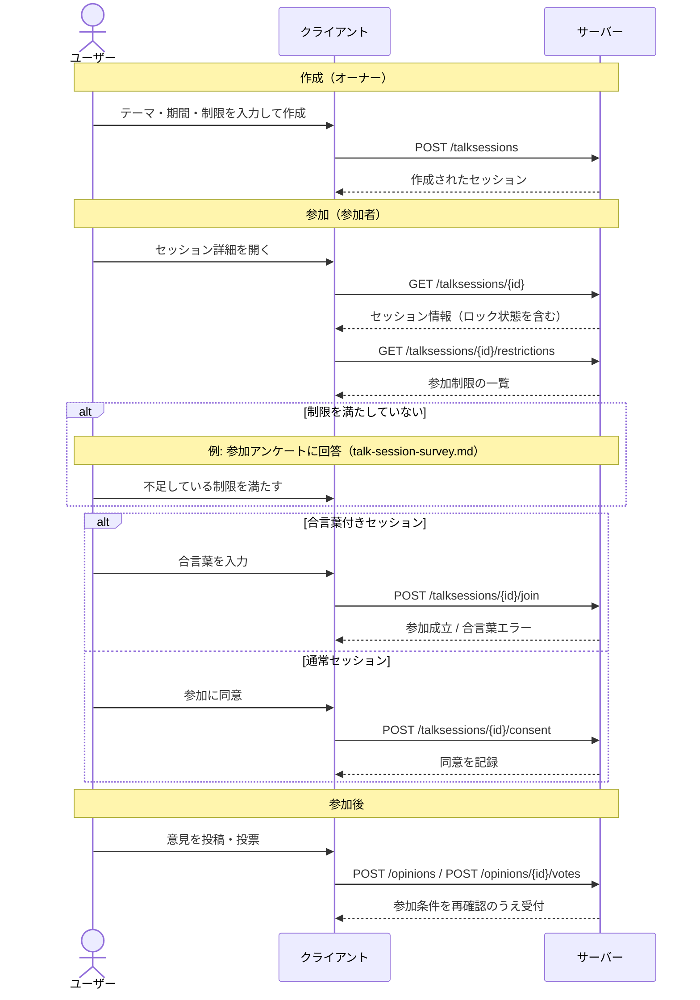
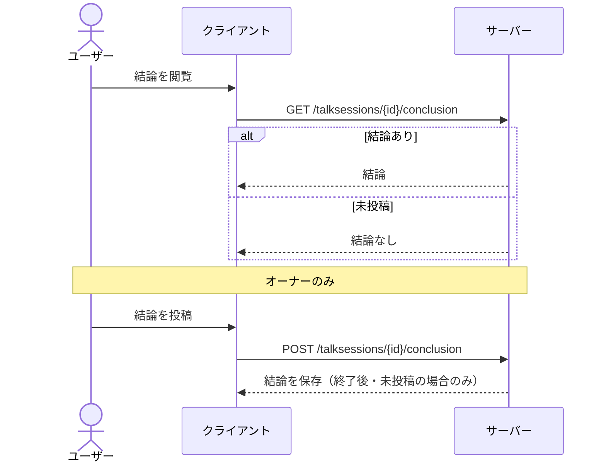

# トークセッション 仕様

## 概要

トークセッションは、あるテーマについて複数のユーザーが意見を投稿し、互いの意見に投票し合うことで議論を可視化する場。
オーナー（作成者）はテーマ・開催期間・参加条件などを設定してセッションを開き、参加者は条件を満たしたうえで意見投稿・投票を行う。
セッション終了後はオーナーが結論を投稿でき、投票結果はグループ分析として集計される。

---

## 用語

| 用語 | 説明 |
| --- | --- |
| トークセッション（TalkSession） | 1 つのテーマについて意見・投票が行われる場。オーナーが管理する |
| オーナー（owner） | セッションを作成し、編集・結論投稿・通報対応を行うユーザー |
| テーマ（theme） | セッションの主題 |
| 終了予定時刻（scheduledEndTime） | この時刻を過ぎるとセッションは終了状態になる |
| 参加制限（restriction） | 参加に必要な条件。デモグラフィック属性や[参加アンケート](./talk-session-survey.md)の回答で構成される |
| 同意（consent） | ユーザーが参加条件に同意し参加した記録。参加時の制限内容がスナップショットされる |
| 合言葉（passphrase） | クローズドセッションへの参加に必要なパスワード。設定するとセッションはロック状態になる |
| 結論（conclusion） | セッション終了後にオーナーが投稿する総括 |
| 意見（[Opinion](./opinion.md)） | セッション内に投稿されるテキスト・画像の投稿 |
| 投票（[Vote](./vote.md)） | 意見に対する賛成 / 反対 / 保留の意思表示 |

---

## ユーザーフロー

### セッション作成

1. 認証済みユーザーがテーマ・終了予定時刻・説明・位置情報・参加制限などを入力して作成する
   - ゲストユーザーは作成できない
2. 必要に応じて合言葉を設定する（設定するとロック状態になり、一覧に表示されなくなる）
3. 必要に応じて[参加アンケート](./talk-session-survey.md)を設定する（作成時のみ設定可能）
4. セッションが作成され、進行中（open）状態になる

### セッションを探す・閲覧する

1. ユーザーがセッション一覧を表示する
   - テーマ・状態（進行中/終了）・並び順（新着 / 古い順 / 返信が多い順 / 近い順）で絞り込める
   - 位置情報を渡すと近い順に並べられる
   - ロックされたセッション、トップ非表示のセッションは一覧に出ない
2. ユーザーがセッション詳細を開く（認証不要）
3. セッションに設定された参加制限を確認する

### セッションへの参加

1. ユーザーがセッションの参加制限を確認する
2. 満たしていない制限がある場合、それを満たす
   - デモグラフィック属性が不足していればプロフィールを登録する
   - [参加アンケート](./talk-session-survey.md)が未回答であれば回答する
3. 合言葉付きセッションの場合は合言葉を入力する
4. 参加条件に同意して参加する。参加時点の制限内容が記録される
5. 参加後、意見投稿・投票ができるようになる

### セッション編集

1. オーナーがテーマ・終了予定時刻・説明・位置情報・各種表示設定を変更する
2. 変更が保存される

### セッション終了と結論

1. 終了予定時刻を過ぎるとセッションは終了状態になる
2. オーナーが結論を投稿する（終了後のみ、1 セッション 1 回）
3. 参加者・閲覧者が結論を閲覧できる

### 通報対応（オーナー）

1. オーナーが自セッションに寄せられた意見への通報一覧・件数を確認する
2. 状態（未対応 / 削除済み / 保留）で絞り込んで対応する

---

## 呼び出しフロー

### セッション作成から参加・投票まで

### セッション終了後

---

## ルールと制約

### 状態遷移

- セッションは作成時に **進行中（open）** となり、終了予定時刻を過ぎると **終了（finished）** になる
- 終了状態になると新規の意見投稿・投票はできない
- 結論の投稿は終了後のみ可能

### 参加条件と同意

- 参加には参加条件への同意が必要。同意した時点の制限内容が記録される（後から制限が変わっても参加時のスナップショットが残る）
- 制限のないセッションは同意のみで参加できる
- 一度同意したユーザーが再度参加操作をしても成立扱いになる（重複して同意は作られない）

### 参加制限（restriction）

セッション作成時に以下の制限を指定できる。

| 制限 | 満たす条件 |
| --- | --- |
| 性別（demographics.gender） | プロフィールに性別が登録済み |
| 生年月日（demographics.birth） | プロフィールに生年月日が登録済み |
| 都道府県（demographics.prefecture） | プロフィールに都道府県が登録済み |
| 市区町村（demographics.city） | プロフィールに市区町村が登録済み（都道府県の登録が前提） |
| アンケート回答済み（survey.answered） | [参加アンケート](./talk-session-survey.md)に回答済み |

- 市区町村の制限は都道府県の制限に依存する（都道府県が満たされなければ市区町村も満たされない）
- ゲストユーザーおよび未認証ユーザーは、制限付きセッションには参加できない

### 合言葉（クローズドセッション）

- 合言葉を設定したセッションはロック状態になり、一覧に表示されない
- 参加には正しい合言葉が必要。間違っている場合は参加できない
- オーナーは合言葉なしで常にアクセスできる
- 既に参加済みのユーザーは合言葉の再入力なしで扱われる

### オーナー権限

以下はオーナーのみが実行できる。

- セッションの編集
- 結論の投稿
- 参加アンケートの作成・編集、回答一覧と集計結果の閲覧
- グループ分析の有効/無効切り替え
- 自セッションへの通報一覧・件数の確認

### 作成・編集の制約

- 終了予定時刻は現在時刻より後でなければならない
- テーマ・説明には文字数上限がある
- 編集はオーナーのみが行える

### 表示・分析の制御

- トップ非表示（hideTop）: ホームのトップ表示から除外する
- レポート非表示（hideReport）: セッションレポートを非表示にする
- 分析無効化（disableAnalysis）: グループ分析を行わない。無効から有効へ切り替えると分析処理がスケジュールされる

### 位置情報と開催期間

- 位置情報（緯度・経度）と地域（都道府県・市区町村）を設定でき、一覧の「近い順」並び替えに使われる
- 開催期間は作成時刻から終了予定時刻まで

---

## 関連ドキュメント

- [意見](./opinion.md) — セッション内に投稿される意見
- [投票](./vote.md) — 意見への賛成 / 反対 / 保留
- [参加アンケート](./talk-session-survey.md) — 参加条件として使えるアンケート
- [認証](./authentication.md) — 参加・作成に必要なログイン
