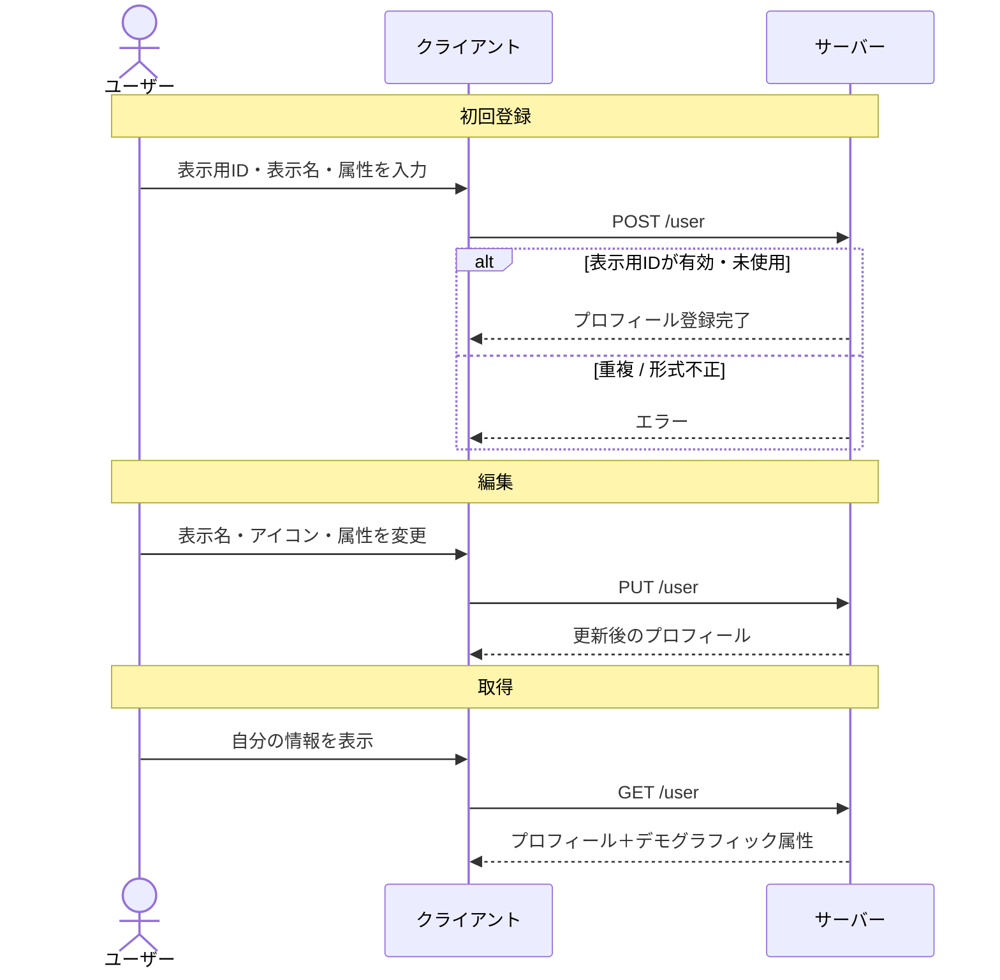

# ユーザー 仕様

## 概要

ユーザーは、表示用ID・表示名・アイコンと、任意のデモグラフィック属性（生年月日・性別・居住地）からなるプロフィールを持つ。
プロフィールの登録によってゲストから正規ユーザーになり、[トークセッション](./talk-session.md)の作成や、属性を条件とするセッションへの参加ができるようになる。

---

## 用語

| 用語 | 説明 |
| --- | --- |
| 表示用ID（displayID） | ユーザーが設定する一意の公開ID（4〜30文字）。プロフィールやURLの識別に使う |
| 表示名（displayName） | 画面に表示される名前 |
| アイコン（iconUrl） | プロフィール画像 |
| デモグラフィック属性（demographics） | 生年月日・性別・都道府県・市区町村などの属性。任意 |
| 登録済み（isRegistered） | 表示用IDと表示名が設定され、プロフィール登録が完了している状態 |

---

## ユーザーフロー

### 初回プロフィール登録

1. ログイン済みユーザーが表示用IDと表示名を入力する
2. 任意でアイコン・生年月日・性別・都道府県・市区町村などを設定する
3. 表示用IDの重複・形式が検証され、問題なければプロフィールが登録される
4. 登録済みユーザーとして各機能が使えるようになる

### プロフィール編集

1. ユーザーが表示名・アイコン・デモグラフィック属性などを変更する
2. 変更が保存される
   - アイコンは差し替えのほか、削除もできる

### 自分・他ユーザーの情報取得

1. ユーザーが自分のプロフィールとデモグラフィック属性を取得する（要認証）
2. 表示用IDを指定して、他ユーザーの公開プロフィールを取得する（認証不要）

### 退会

退会と復活については [退会](./withdraw.md) を参照。

---

## 呼び出しフロー

---

## ルールと制約

### 表示用ID（displayID）

- 全ユーザーの中で一意
- 4〜30 文字であること（空は不可）
- 重複・文字数違反の場合は登録できない

### 表示名（displayName）

- プロフィール登録時に必須
- ゲストユーザーは表示名を変更できない（正規ユーザーへのログインが必要）

### デモグラフィック属性（demographics）

すべて任意項目。設定した属性は、属性を参加条件とするセッションの[参加制限](./talk-session.md)を満たすために使われる。

| 属性 | 説明 |
| --- | --- |
| 生年月日 | 妥当な日付であること |
| 性別 | 男性 / 女性 / その他 から選択 |
| 都道府県 | 居住する都道府県 |
| 市区町村 | 居住する市区町村 |

### アイコン

- 画像をアップロードして設定し、差し替え・削除ができる

### 退会

- プロフィール登録済みのユーザーが退会できる。退会すると全セッションが無効化される。詳細は [退会](./withdraw.md) を参照

---

## 関連ドキュメント

- [認証](./authentication.md) — ログインとセッション
- [退会](./withdraw.md) — 退会と復活
- [トークセッション](./talk-session.md) — デモグラフィック属性が参加条件として使われる
