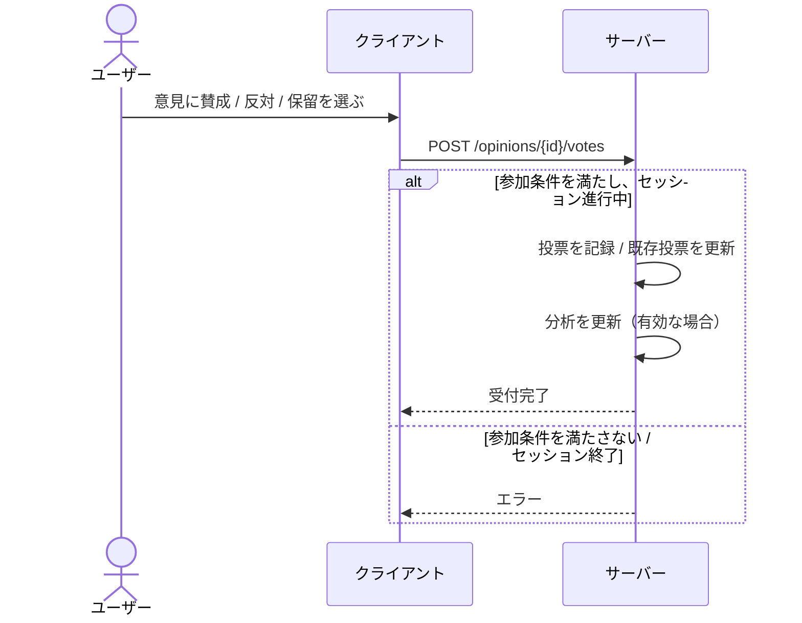

# 投票 仕様

## 概要

投票は、[トークセッション](./talk-session.md)内の[意見](./opinion.md)に対して、ユーザーが賛成・反対・保留の意思を示す機能。
1 ユーザーは 1 つの意見に 1 回投票でき、後から変更できる。
投票結果はグループ分析として集計され、属性別の賛否傾向の可視化に使われる。

---

## 用語

| 用語 | 説明 |
| --- | --- |
| 投票（Vote） | ユーザーが意見に対して行う意思表示 |
| 賛成（agree） | 意見に賛成する投票 |
| 反対（disagree） | 意見に反対する投票 |
| 保留（pass） | どちらでもない／判断しない投票 |
| 未投票 | まだ投票していない状態。投票記録としては残らない |

---

## ユーザーフロー

### 意見に投票する

1. 参加者が意見に対して賛成 / 反対 / 保留のいずれかを選ぶ
   - 投票には参加条件を満たしている必要がある
2. 投票が記録される
3. セッションで分析が有効な場合、投票をもとに分析が更新される

### 投票を変更する

1. 参加者が既に投票した意見に対して別の選択をする
2. 既存の投票が新しい内容に上書きされる

### 自分の投票状態を確認する

1. ユーザーが意見一覧や意見詳細を開く
2. ログイン済みなら、各意見に対する自分の投票状態が一緒に返される

---

## 呼び出しフロー

---

## ルールと制約

### 投票の値

- 投票の値は賛成・反対・保留のいずれか
- 投票を「取り消す」操作はなく、別の値への変更のみ可能

### 投票の前提条件

- 投票には認証が必要
- 投票者はセッションの参加条件を満たしている必要がある（[参加アンケート](./talk-session-survey.md)未回答などでは投票不可）。投票のたびに参加条件が再確認される
- 終了したセッションには投票できない

### 1 ユーザー 1 意見 1 投票

- 同じユーザーは同じ意見に対して 1 つの投票しか持たない
- 既存の投票への再投票は上書きとして扱われる
- [意見](./opinion.md)を投稿すると、投稿者にはその意見への「賛成」投票が自動で作られる。その後、投稿者自身が値を変更することもできる

### 集計

- 投票は意見ごと・属性グループごとに集計され、賛成 / 反対 / 保留の傾向として分析に使われる
- 分析が無効化されたセッションでは投票時の分析更新は行われない

---

## 関連ドキュメント

- [意見](./opinion.md) — 投票の対象
- [トークセッション](./talk-session.md) — 投票が行われる場
- [参加アンケート](./talk-session-survey.md) — 投票の前提になる参加条件
